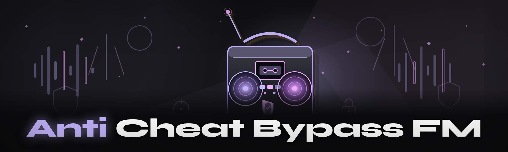

  
  
  

  

  
  
  

---

Anti-cheat bypass FM research: HWID spoofer, kernel driver unloader, EAC/BE bypass, VM-detect evasion, signature swapping for cheats.

## Overview

Anti-cheat bypass FM research: HWID spoofer, kernel driver unloader, EAC/BE bypass, VM-detect evasion, signature swapping for cheats.

  

## License

[MIT License](LICENSE)

  

